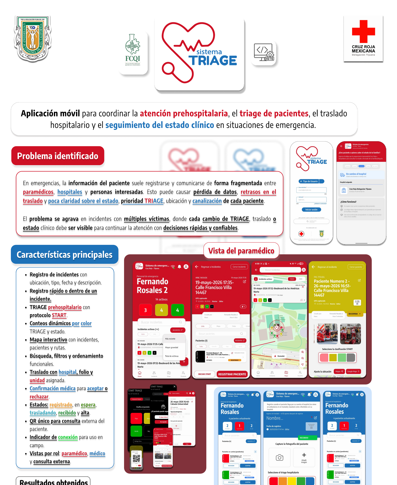
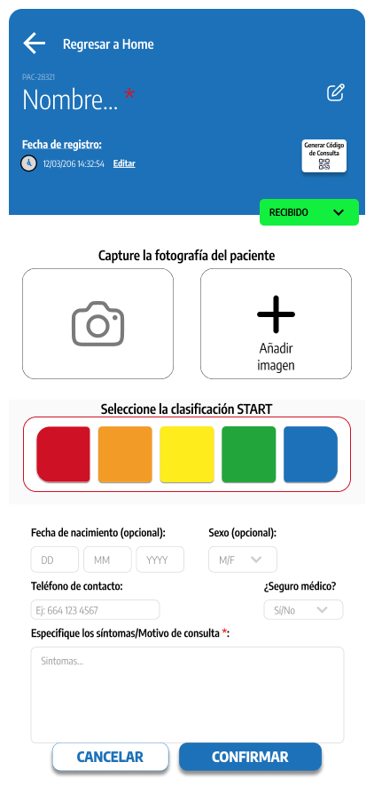
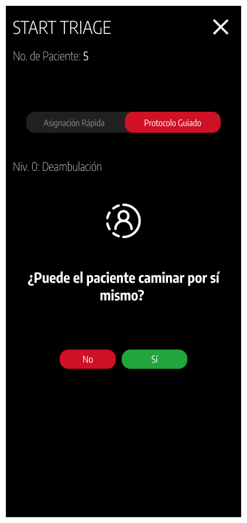
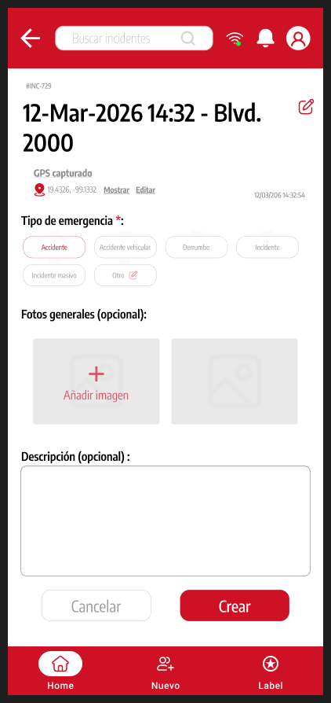
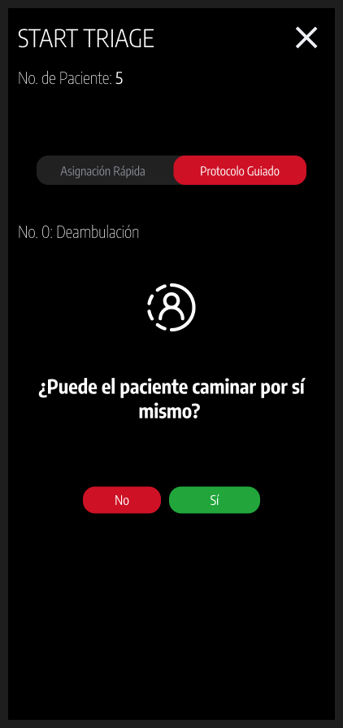

# SystemTriage

### Información útil en momentos críticos

Proyecto móvil para apoyar flujos de triaje e incidentes de emergencia, con vistas para personal paramédico y hospitalario.

**Periodo documentado:** 2026  
**Estado:** Proyecto documentado con prototipo, maquetas y video público  
**Tecnologías:** Flutter · Dart · diseño de experiencia

## Qué hace

- Registro de incidentes y pacientes con flujos orientados a roles.
- Clasificación de triaje guiada y vistas de seguimiento.
- Exploración visual de colas, mapas y coordinación de atención.

## Vista del proyecto

Póster y maquetas del proyecto de 2026. Las dos pantallas añadidas provienen del archivo original de Figma y son diseños de interfaz.

### Logo vectorial de SystemTriage

### Extracto del póster de SystemTriage

### Maqueta del registro de paciente

### Maqueta del flujo de clasificación guiada

### Diseño Figma del registro de incidente

### Diseño Figma del inicio de triage guiado

## Contexto

Proyecto vinculado con UABC y Cruz Roja, según la presentación pública del equipo.

Esta vitrina contiene únicamente texto e imágenes seleccionadas para presentación. El código fuente, los datos y el historial del proyecto no se publican aquí.

[Ver la ficha visual de SystemTriage](https://alfredoae2578.github.io/projects/systemtriage-presentacion.html)

[Ver todos los proyectos](https://alfredoae2578.github.io/)
